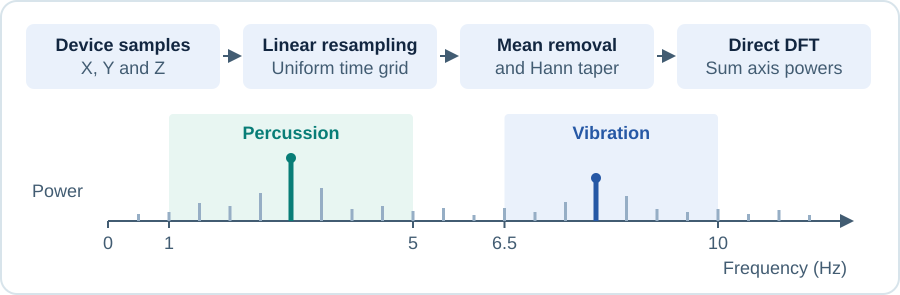
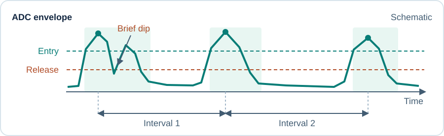
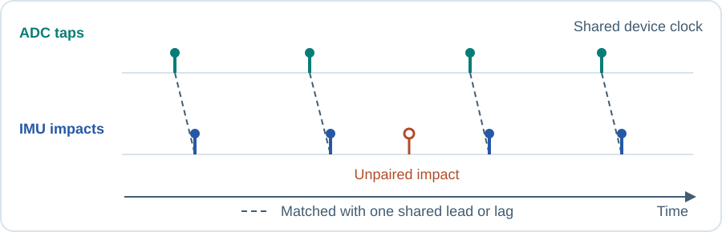
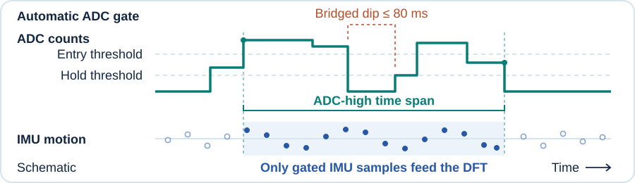

# Frequency estimation methods

This reference describes the five series in **IMU frequency analysis** in app
version **1.1.1+3**. The editable default bands are **1–5 Hz** for percussion and
**6.5–10 Hz** for vibration.

| Series | Input | Method | Reported value |
| --- | --- | --- | --- |
| IMU percussion | Selected IMU signal, X/Y/Z | Sum of three axis spectra, searched in the percussion band | Frequency of the strongest accepted bin |
| IMU vibration | Selected IMU signal, X/Y/Z | The same spectrum, searched in the vibration band | Frequency of the strongest accepted bin |
| ADC percussion | Selected ADC channel | Adaptive tap detection and median tap interval | Typical detected tap cadence |
| Fused percussion | Selected ADC channel and IMU signal | One-to-one matching of ADC taps and IMU impacts by device timestamp | Typical cadence of matched ADC taps |
| Fused vibration | Selected ADC channel and IMU signal | ADC gate followed by an IMU spectrum within each sustained high interval | Frequency of an accepted vibration peak inside a gated interval |

## Input and time alignment

- The analysis page offers three-axis acceleration in `g` or angular velocity
  in `°/s`. It defaults to acceleration. The model also accepts valid raw
  magnetometer vectors in counts, though the page offers only acceleration and
  angular velocity. ADC analysis uses raw counts from one selected channel,
  defaulting to channel 1.
- The app expands BLE batches into individual local samples (`gloveId == 0`).
  All frequency calculations use device timestamps in milliseconds. BLE arrival
  time is used for stream freshness and page buffer retention. The page keeps up
  to 12 seconds and 4,096 records per stream and treats a stream as stale after
  3 seconds without incoming records. Disconnect resets the analysis session.
- Both estimators handle unsigned 32-bit timestamp rollover, treat a backward
  jump as a new device-clock epoch, and skip duplicate timestamps.
- ADC and fusion examine up to 12 seconds and 4,096 distinct samples per input.
  They skip isolated invalid or inactive samples, require recent valid ADC
  data from an active selected channel, and keep the data after the last gap
  larger than `max(3.25 × median interval, median interval + 20 ms)`. Brief gaps
  retain their real elapsed time.
- Fusion uses the timestamp overlap of both valid streams from the same glove.
  It rejects an overlap ending more than 1.5 seconds behind the newest stream.
  ADC and fusion calculate the observed rate as
  `1,000 × (sample count − 1) / elapsed milliseconds` with at least three
  samples. Fused results report this rate for the overlapping IMU data.

See the [analysis page](../lib/widgets/imu_analysis_page.dart),
[BLE ingestion](../lib/main.dart), and [ADC/fusion model](../lib/models/adc_frequency_analysis.dart).

## IMU percussion and vibration

Both series use the same three-axis **direct discrete Fourier transform (DFT)**
and choose a peak within their respective bands.

*Figure 1. One IMU spectrum supplies both band estimates. The heights and
selected peaks are illustrative.*

1. **Select a window.** Use the latest 8 seconds of distinct device timestamps.
   Require at least three samples, at least 1 second of data, and valid values
   for the selected signal throughout the window. Reject gaps larger than
   `max(2.5 × median interval, median interval + 10 ms)`.
2. **Estimate the sample rate and resample.** Use the lower of the rates implied
   by the median interval and by the mean interval. Require at least 2 Hz. Use
   linear interpolation on an evenly spaced grid at that rate, with 3–4,096
   resampled points.
3. **Remove DC and taper the signal.** Subtract each axis mean and multiply by
   a Hann window. This removes a constant offset and reduces spectral leakage.
4. **Compute power.** Evaluate each positive-frequency DFT bin up to
   `0.4 × observed sample rate`. Sum `real² + imaginary²` across X, Y and Z.
   Bin spacing is `observed sample rate / resampled point count`. The displayed
   Nyquist frequency is `observed sample rate / 2`.
5. **Check the band and choose a peak.** Require the entire band below or at
   the `0.4 × rate` cutoff, enough duration for two cycles at the lower band
   edge, at least five bins in the band, and windowed energy of at least
   `1 × 10⁻¹²`. The strongest in-band bin must have at least 1% of the maximum
   power across all computed bins and at least five times the upper median
   in-band power. Return the bin center in Hz, with no interpolation between
   bins.

See [IMU frequency analysis](../lib/models/imu_frequency_analysis.dart).

## ADC percussion

The standalone estimate uses the selected channel from the most recent ADC segment
without a long gap. It selects one of two tap detectors. Percentiles are linearly
interpolated over sorted values.

*Figure 2. Entry opens a contact. A confirmed release ends it, so a brief dip
does not create a second tap.*

- **Raw-level peaks.** Let the baseline be the 20th percentile of ADC levels, the
  contrast be the 99.5th percentile minus the baseline, and the prominence floor be
  `max(8.0, 3.5 × median absolute step)`, where steps are differences between
  consecutive ADC readings. Contrast must be at least the prominence floor. The
  detection threshold is `baseline + max(prominence floor, 0.22 × contrast)`. Each
  contiguous run at or above threshold yields one peak at the integer midpoint of the
  first and last timestamps attaining that run's maximum. Runs touching either window
  edge are discarded. This path rejects the band up front if its lower bound exceeds
  `0.4 × ADC sample rate`.
- **Noisy-signal contact envelope.** The detector first looks at the tail covering
  `round(min(12,000, max(4,000, 4,000 / band.minHz)))` ms, ending at the last ADC
  sample. With fewer than three tail samples or a noise estimate below `8.0`, it uses
  the raw-level path. The noise estimate is `3.5 × median absolute step` in this shorter
  tail. Otherwise it clips the signal below `20th-percentile level + noise` to zero by
  taking the positive excess above that floor. It averages the excess over the samples
  within ±20 ms of each timestamp, weighting each sample equally. The envelope entry
  threshold is `max(noise / 4, 0.22 × 99.5th-percentile envelope)`. Contact starts at or
  above that threshold and must stay below `0.55 × entry threshold` for at least 30 ms,
  measured at sample timestamps, to finish. A rise back to the release threshold during
  that dip cancels the pending release. The detector keeps the timestamp of the first
  maximum. It measures contact length from entry to the first sample of the confirmed
  release and accepts lengths up to `min(450, 500 / band.minHz)` ms. A contact starting
  on the first envelope sample or lacking a confirmed release by the end yields no peak.
  Once selected, the envelope remains the source of peaks even if its cadence is
  unavailable.

**Cadence.** The estimator takes intervals between consecutive detected peaks and
retains those from `1000 / min(band.maxHz, 0.4 × ADC sample rate)` up to
`1000 / band.minHz` milliseconds, inclusive. It requires at least two retained intervals and rejects the
estimate if shorter intervals outnumber the retained ones. Longer intervals are ignored.
The reported frequency is `1000 / median(retained intervals in ms)`. The estimate
reflects observed intervals, so missed or extra peaks can change the result. The
intervals include only the detected events.

## Fused percussion

Fusion repeats ADC peak detection inside the shared ADC–IMU time span, using the same
raw-level versus envelope selection. IMU impacts qualify the ADC events by timestamp.
The cadence is calculated from the matched ADC timestamps with the same interval rules
and a ceiling of `0.4 × IMU sample rate`. Fusion can produce a cadence independently of
the standalone ADC readout. The raw-level ADC detector applies its ADC sample-rate check
before producing peaks. The envelope path passes its detected contacts to the matcher
directly.

*Figure 3. The matcher tests a shared time offset. Only the matched ADC tap
timestamps contribute to the fused cadence.*

- **Raw-level ADC peaks.** Fusion requires at least three ADC peaks and rejects a band
  whose lower edge exceeds `0.4 × IMU sample rate`. It tests each of the three axes
  separately at both signs. For each signed signal, the baseline is its median and the
  contrast is the 98.5th percentile minus that baseline. Minimum contrast is `0.002 g`
  for accelerometer, `0.25 degrees/s` for gyroscope, and `4.0 counts` for magnetometer.
  IMU peaks come from runs at or above `baseline + 0.5 × contrast`, using the same peak
  timestamp and edge rules as raw ADC. Of the axis/sign candidates with a valid cadence,
  the one with the most matches wins, with ties keeping the first. If none yields a
  cadence, the detector applies the same contrast, peak, and matching rules to the
  Euclidean distance from the vector of per-axis medians. The match tolerance is
  `clamp(1000 / IMU sample rate, 20, 35)` ms.
- **Noisy ADC envelope contacts.** Fusion requires at least three ADC contacts and at
  least three IMU change samples at or after the envelope cutoff. Each change sample is
  the Euclidean norm of the three-axis difference from the previous IMU sample, placed
  at the later timestamp. A gap greater than `2500 / IMU sample rate` ms contributes a
  zero. Contrast is the 98.5th percentile of these changes minus their median and must
  be positive. The peak threshold is `median + 0.45 × contrast`. The detector applies
  the same peak timestamp and edge rules and merges successive peaks closer than
  `round(min(110, 500 / band.maxHz))` ms, retaining the stronger peak and keeping the
  earlier one on ties. The match tolerance is `clamp(1500 / IMU sample rate, 25, 35)`
  ms.

**Time-aligned matching.** The matcher tries one shared lag for the whole window, from
−90 through +90 ms in 10 ms steps. At each lag it pairs events greedily in timestamp
order, one-to-one, when `abs((IMU timestamp − ADC timestamp) − lag)` is within
tolerance. It requires at least three pairs, coverage of at least two-thirds of the ADC
peaks (rounded up), and coverage of at least two-thirds of IMU peaks (rounded up) on the
raw path or a strict majority of IMU peaks on the envelope path. The absolute median of
the observed signed offsets must be at most 90 ms. It favors the most matches, then the
lowest total absolute residual. Cadence uses the selected match set, so dropping an
unmatched ADC event can lengthen the interval between surviving events. The common lag
and coverage rules can reject real events when impact timing varies or either detector
produces too many unmatched events.

## Fused vibration

Estimate the vibration band from IMU samples inside sustained ADC-high
intervals in the shared window.

*Figure 4. The ADC gate keeps IMU samples inside the highlighted interval,
including the bridged dip.*

- **Automatic gate.** Use the 3rd percentile as the baseline and the 90th
  percentile minus baseline as contrast. Require at least 8 counts of
  contrast. Entry is `baseline + 0.65 × contrast` and hold is
  `baseline + 0.45 × contrast`. Start at the first sample meeting entry in a
  run at or above hold.
- **Manual gate.** Set **Vibration gate** to an integer from −32,768 to 32,767
  counts for the selected channel. That value is the inclusive entry and
  hold threshold. Clear the field to restore automatic gating.
- **Sustained high.** Bridge dips of up to 80 ms from the first below-hold
  sample to the next sample meeting hold. Bridged dips must total at most
  one-third of the accepted interval. A longer dip ends the interval.
  Keep IMU samples between the ADC endpoints, including bridged dips.
- **Spectral estimate.** Require at least three IMU samples spanning at
  least 1,000 ms. Try intervals separately in descending IMU sample count,
  with a 12-second maximum window and the same DFT and band checks as above.
  Return the first accepted peak or the first interval's failure reason.
  With no eligible interval, the app waits for a sustained ADC high.

See [ADC and fused frequency analysis](../lib/models/adc_frequency_analysis.dart).

## Reading the results

- IMU estimates represent dominant periodic components. Harmonics, noise,
  limited bin resolution, and aliasing can affect them. The sum of axis
  powers is invariant to a fixed rotation of the axes.
- An ADC or fused percussion estimate is a cadence of detected events. Uneven
  taps can yield a cadence, and a cadence need not appear as a distinct IMU
  spectrum peak. A fused vibration estimate is an IMU spectrum peak during an
  ADC-confirmed contact. It can remain visible while that interval is still in
  the rolling window after release.
- The display updates about once per second. A dash marks missing evidence.
  History breaks at missing values, gaps over 2 seconds, or changes to
  the relevant signal, ADC channel, subscription, band, or gate.
- CSV uses estimate generation time and one row per source and band. For
  example, `sensor` can be `fused_accelerometer_adc_ch_1`. A blank
  `candidate_peak_hz` is explained by `unavailable_reason`.

See the [frequency plot](../lib/widgets/frequency_history_chart.dart) and
[CSV exporter](../lib/models/frequency_recording_csv.dart).
